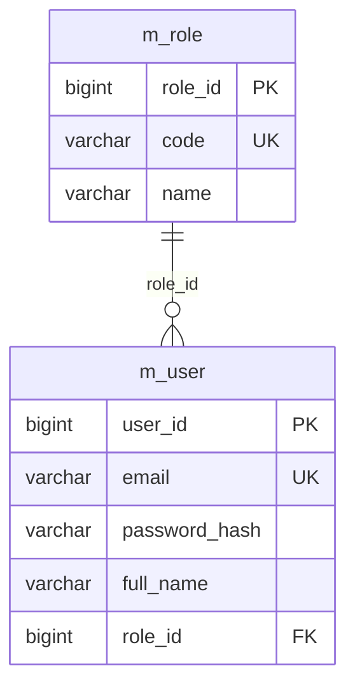

# Cấu trúc module và phân quyền

Mọi tài khoản đăng nhập dùng bảng `m_user`, liên kết một role trong `m_role` qua `role_id`.

## Cấu trúc source

Tên package viết thường theo quy ước Java. Mỗi module chia lớp theo trách nhiệm:

```text
com/erhms/
├── user/
│   ├── entity/User.java
│   ├── controller/AuthController.java
│   ├── repository/UserRepository.java
│   ├── service/CurrentUser.java
│   └── dto/UserView.java
├── role/
│   ├── entity/Role.java
│   └── repository/RoleRepository.java
├── recruitment/
│   ├── entity/
│   ├── controller/
│   ├── repository/
│   ├── service/
│   ├── dto/
│   └── enums/
└── shared/
    ├── config/
    └── exception/
```

- `entity`: ánh xạ bảng và quan hệ JPA.
- `controller`: tiếp nhận HTTP request, kiểm tra input và gọi service.
- `repository`: truy vấn, lưu dữ liệu.
- `service`: xử lý nghiệp vụ và xác định user hiện tại.
- `dto`: dữ liệu request/response API.
- `enums`: các giá trị trạng thái và ca làm việc.

## Bảng tài khoản



- `m_user.user_id`: khóa chính `BIGINT`, tự cấp từ `m_user_seq`.
- `m_role.role_id`: khóa chính `BIGINT`, tự cấp từ `m_role_seq`.
- `m_user.role_id`: bắt buộc, khóa ngoại tới `m_role.role_id`.
- Hai sequence bắt đầu từ 1, tăng mỗi lần 1; JPA dùng `GenerationType.SEQUENCE`, `allocationSize = 1`.
- Tạo user/role mới bằng cách để `id` bằng null; email user và mã role `code` là duy nhất.
- Role mặc định gồm `USER` và `SERVICE_MANAGER`.

Entity tài khoản là `user.entity.User`. `GET /api/auth/me` trả `id`, `email`, `fullName`, `role`, `roleId`.

## Quyền với yêu cầu tuyển dụng

`USER` tạo, xem, sửa và gửi yêu cầu do chính mình tạo. `SERVICE_MANAGER` được xem các yêu cầu và thực hiện các bước duyệt/đóng. Quy tắc cấm tự duyệt, trạng thái và kiểm tra version tiếp tục được áp dụng.

Yêu cầu được xác định chủ sở hữu qua `recruitment_requests.created_by`, tham chiếu `m_user.user_id`. Response yêu cầu trả `userId` và `userName` của người tạo.

## Khởi tạo database mới và dữ liệu demo

Dự án dùng migration `src/main/resources/db/migration/V1__init_erhms_with_demo.sql` để tạo schema tuyển dụng với hai sequence, bốn bảng và dữ liệu demo. Migration `V2__create_consultation_registrations.sql` thêm bảng tư vấn; V3 chuyển bảng tư vấn sang 8 cột hiện tại, với `program_name` lưu tên hiển thị của ngành/khóa học.

### 1. Tạo database PostgreSQL rỗng

Mở Query Tool kết nối tới database `postgres` và chạy:

```sql
CREATE DATABASE erhms ENCODING 'UTF8';
```

Sau đó ứng dụng kết nối tới `jdbc:postgresql://localhost:5432/erhms`. Tài khoản PostgreSQL mặc định là `postgres`/`postgres`; có thể cấu hình qua `DB_URL`, `DB_USER`, `DB_PASSWORD`.

### 2. Khởi động ứng dụng

```powershell
mvn spring-boot:run
```

Khi bật `spring.flyway.enabled`, database rỗng chạy V1, V2, V3 một lần, tạo bảng `m_role`, `m_user`, `recruitment_requests`, `request_events`, `consultation_registrations`, cùng hai sequence `m_role_seq`, `m_user_seq`. Với database đã có schema V1 nhưng chưa có lịch sử Flyway, cấu hình `baseline-on-migrate: true`, `baseline-version: 1` giữ dữ liệu hiện có và chạy V2, V3. Những lần khởi động sau chỉ chạy các migration chưa áp dụng. Cấu hình ứng dụng hiện tại đang tắt Flyway; cần bật lại khi muốn áp dụng migration tự động.

### 3. Tài khoản demo

Mật khẩu chung: **`Demo@123456`**. Trong database, mật khẩu được lưu dưới dạng BCrypt.

| Email | Role | Yêu cầu sở hữu |
| --- | --- | --- |
| `user1@erhms.local` | `USER` | 3 |
| `user2@erhms.local` | `USER` | 2 |
| `manager@erhms.local` | `SERVICE_MANAGER` | Xem cả 5 yêu cầu |

Demo gồm 5 yêu cầu ở các trạng thái `DRAFT`, `SUBMITTED`, `REVISION_REQUIRED`, `APPROVED`, `CLOSED`, cùng 13 sự kiện lịch sử tương ứng. Ngày cần nhân sự được tính tương đối từ ngày chạy migration.

Các role/user demo được cấp ID qua sequence. Khi tạo mới, ID tiếp tục tăng sau dữ liệu demo.

## Kiểm thử

```powershell
mvn clean verify
```

Kiểm thử dùng H2 ở chế độ PostgreSQL, chạy migration thật và Hibernate `validate`. Các trường hợp bao gồm khởi tạo schema mới, dữ liệu demo, BCrypt, sequence, khóa ngoại, đăng nhập và quyền theo user sở hữu yêu cầu.
