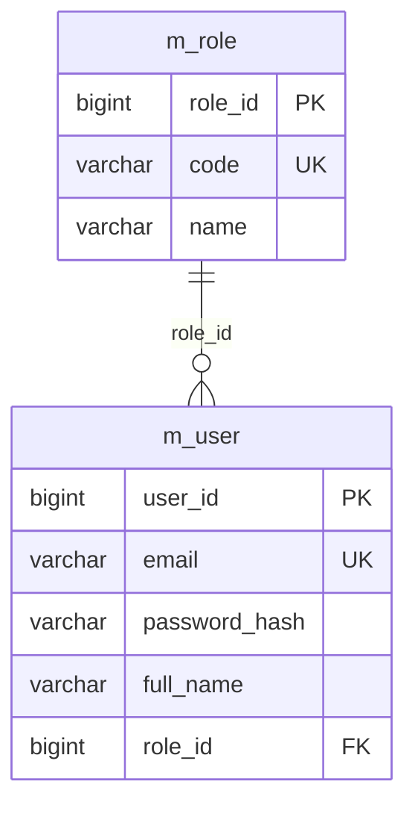

# Cấu trúc module và phân quyền

Mọi tài khoản đăng nhập dùng bảng `m_user`, liên kết một role trong `m_role` qua `role_id`.

## Cấu trúc source

Tên package viết thường theo quy ước Java. Mỗi module chia lớp theo trách nhiệm:

```text
com/erhms/
├── user/
│   ├── entity/User.java
│   ├── controller/AuthController.java
│   ├── repository/UserRepository.java
│   ├── service/CurrentUser.java
│   └── dto/UserView.java
├── role/
│   ├── entity/Role.java
│   └── repository/RoleRepository.java
├── recruitment/
│   ├── entity/
│   ├── controller/
│   ├── repository/
│   ├── service/
│   ├── dto/
│   └── enums/
└── shared/
    ├── config/
    └── exception/
```

- `entity`: ánh xạ bảng và quan hệ JPA.
- `controller`: tiếp nhận HTTP request, kiểm tra input và gọi service.
- `repository`: truy vấn, lưu dữ liệu.
- `service`: xử lý nghiệp vụ và xác định user hiện tại.
- `dto`: dữ liệu request/response API.
- `enums`: các giá trị trạng thái và ca làm việc.

## Bảng tài khoản



- `m_user.user_id`: khóa chính `BIGINT`, tự cấp từ `m_user_seq`.
- `m_role.role_id`: khóa chính `BIGINT`; bảy role được hỗ trợ có ID cố định 1–7. Sequence `m_role_seq` chỉ cấp ID mới cho các dòng bổ sung; các dòng ngoài bộ chuẩn không được đăng nhập.
- `m_user.role_id`: bắt buộc, khóa ngoại tới `m_role.role_id`.
- Hai sequence bắt đầu từ 1, tăng mỗi lần 1; JPA dùng `GenerationType.SEQUENCE`, `allocationSize = 1`.
- Tạo user mới bằng cách để `id` bằng null và gán một role chuẩn đã có; email user và mã role `code` là duy nhất.
- Cặp `role_id`/`code` hợp lệ: `1/ADMIN`, `2/LECTURER`, `3/STUDENT`, `4/ACCOUNTANT`, `5/IT_SUPPORT`, `6/MANAGER`, `7/HR`. Kiểm tra chính xác, phân biệt chữ hoa/thường. ID ngoài 1–7, thiếu role hoặc mã sai ID trả `403`; các alias cũ không được chấp nhận lúc chạy. Xem [hướng dẫn dashboard](../../docs/DASHBOARDS.md).

Entity tài khoản là `user.entity.User`. `GET /api/auth/me` trả `id`, `email`, `fullName`, `role`, `roleId`.

## Quyền với yêu cầu tuyển dụng

`HR` (ID 7) tạo, xem, sửa và gửi yêu cầu do chính mình tạo. `MANAGER` (ID 6) được xem các yêu cầu và thực hiện các bước duyệt/đóng. Quy tắc cấm tự duyệt, trạng thái và kiểm tra version tiếp tục được áp dụng. Quyền lấy lại từ database mỗi lần gọi API, kể cả khi đã có session.

Yêu cầu được xác định chủ sở hữu qua `recruitment_requests.created_by`, tham chiếu `m_user.user_id`. Response yêu cầu trả `userId` và `userName` của người tạo.

## Khởi tạo database mới và dữ liệu demo

Dự án dùng migration `src/main/resources/db/migration/V1__init_erhms_with_demo.sql` để tạo schema tuyển dụng với hai sequence, bốn bảng và dữ liệu demo. Migration `V2__create_consultation_registrations.sql` thêm bảng tư vấn; V3 chuyển bảng tư vấn sang 8 cột hiện tại, với `program_name` lưu tên hiển thị của ngành/khóa học.

### 1. Tạo database PostgreSQL rỗng

Mở Query Tool kết nối tới database `postgres` và chạy:

```sql
CREATE DATABASE erhms ENCODING 'UTF8';
```

Sau đó ứng dụng kết nối tới `jdbc:postgresql://localhost:5432/erhms`. Tài khoản PostgreSQL mặc định là `postgres`/`postgres`; có thể cấu hình qua `DB_URL`, `DB_USER`, `DB_PASSWORD`.

### 2. Khởi động ứng dụng

```powershell
mvn spring-boot:run
```

Flyway mặc định bật (`FLYWAY_ENABLED=true`). Database rỗng chạy V1–V6; database có schema V1 nhưng chưa có lịch sử Flyway dùng baseline 1 và chạy V2–V6. V4 bổ sung điện thoại; V5 thêm trạng thái tài khoản, nhật ký đăng nhập và nguồn dữ liệu dashboard. V6 chuyển bộ role V5 cũ sang các ID cố định nêu trên, chuyển tài khoản `USER` về `HR` và `SERVICE_MANAGER` về `MANAGER`, giữ nguyên ID/mật khẩu user và liên kết dữ liệu nghiệp vụ. Bộ role đã đúng chuẩn được giữ nguyên. Những lần khởi động sau chỉ chạy migration chưa áp dụng.

### 3. Tài khoản demo

Mật khẩu chung: **`Demo@123456`**. Trong database, mật khẩu được lưu dưới dạng BCrypt.

| Email | Role | Yêu cầu sở hữu |
| --- | --- | --- |
| `user1@erhms.local` | `HR` (ID 7) | 3 |
| `user2@erhms.local` | `HR` (ID 7) | 2 |
| `manager@erhms.local` | `MANAGER` (ID 6) | Xem cả 5 yêu cầu |

Demo gồm 5 yêu cầu ở các trạng thái `DRAFT`, `SUBMITTED`, `REVISION_REQUIRED`, `APPROVED`, `CLOSED`, cùng 13 sự kiện lịch sử tương ứng. Ngày cần nhân sự được tính tương đối từ ngày chạy migration.

Các user demo được cấp ID qua sequence; role cuối cùng dùng ID cố định theo V6. Khi tạo user mới, ID tiếp tục tăng sau dữ liệu demo.

## Kiểm thử

```powershell
mvn clean verify
```

Kiểm thử dùng H2 ở chế độ PostgreSQL, chạy migration thật và Hibernate `validate`. Các trường hợp bao gồm khởi tạo schema mới, dữ liệu demo, BCrypt, sequence, khóa ngoại, đăng nhập và quyền theo user sở hữu yêu cầu.
