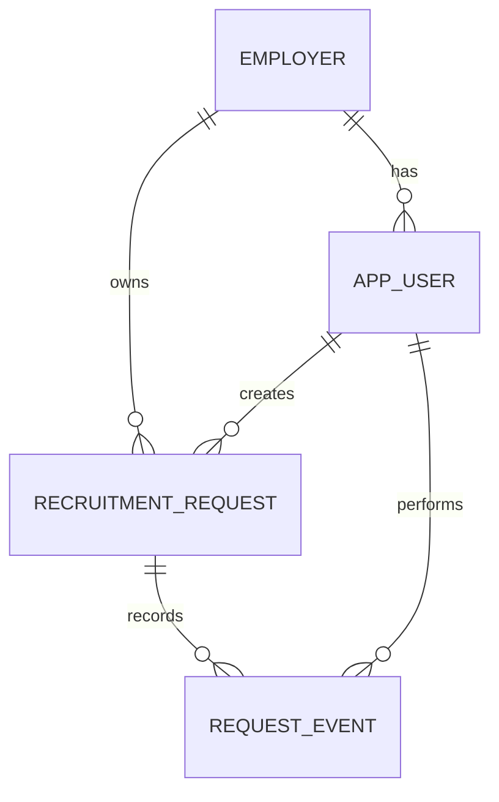

# Kiến trúc bộ khung KCN Connect

## Phạm vi đã viết mã
Một ứng dụng Spring Boot phục vụ một khu công nghiệp, nhiều doanh nghiệp. React là frontend độc lập. Nginx proxy `/api` tới backend trong Docker; Vite proxy trong chế độ phát triển. Cùng origin giúp dùng session cookie và CSRF mà không cần CORS mở rộng.

- `identity`: tài khoản, lấy người dùng hiện tại, đăng nhập bằng Spring Security.
- `employer`: doanh nghiệp.
- `recruitment`: controller → service giao dịch → repository/entity; DTO tách khỏi entity; lịch sử sự kiện.
- `shared`: bảo mật, xử lý lỗi, seed dữ liệu phát triển.

Chưa tạo các bảng/endpoint giả cho phần chưa thực hiện. Khi mở rộng hãy thêm `worker`, `training`, `placement`, `privacy`, `notification`, `reporting` theo bài toán đã thống nhất. Giữ Application, Enrollment, Placement là ba đối tượng riêng.

## Trạng thái nhu cầu
`DRAFT → SUBMITTED → APPROVED → CLOSED`

Nhánh bổ sung: `SUBMITTED → REVISION_REQUIRED → SUBMITTED`.
Nhân sự cùng doanh nghiệp được xem/sửa bản nháp, sửa yêu cầu cần chỉnh sửa và gửi duyệt. Quản lý xem tất cả doanh nghiệp, duyệt/yêu cầu sửa và đóng. Người tạo không tự duyệt bản ghi. Chỉ hai vai trò trên đã được cài đặt trong starter.

## Quy tắc
- Không nhận employerId từ frontend để quyết định phạm vi tạo dữ liệu. Backend lấy từ tài khoản.
- Số lượng 1–10.000, vị trí/địa điểm/kỹ năng bắt buộc, ngày cần nhân sự không ở quá khứ theo Asia/Ho_Chi_Minh.
- Yêu cầu chỉnh sửa cần lý do.
- Bản ghi có version; cập nhật dùng khóa hàng trong giao dịch và kiểm tra version để phát hiện màn hình cũ.
- Mọi thay đổi nghiệp vụ ghi request_events trong cùng giao dịch, có actor_id và thời điểm. API lịch sử trả hành động/thời gian/ghi chú; chưa có màn hình quản trị audit riêng.
- Dữ liệu doanh nghiệp khác trả 404 để không lộ bản ghi; hành động sai quyền trả 403; sai trạng thái/version trả 409.
- Chưa triển khai notification, đăng ký, quên mật khẩu, phân quyền bảy vai trò, phân lớp, ứng tuyển, offer, chống brute force hay triển khai production.

## Bảo mật và cấu hình
Mật khẩu lưu BCrypt. Session cookie HttpOnly + SameSite Lax. CSRF bật cả login/logout; FE lấy token từ `/api/auth/csrf` và lấy lại sau login. Mật khẩu không lưu localStorage. Phiên mất khi backend khởi động lại. Cổng Docker mặc định chỉ bind 127.0.0.1. Muốn dùng ngoài máy phát triển cần cấu hình HTTPS, cookie Secure, tài khoản thật, giới hạn đăng nhập, backup và quản lý secret trước.

## ERD

## Nguồn kỹ thuật tham khảo
- https://docs.spring.io/spring-boot/3.5/system-requirements.html
- https://docs.spring.io/spring-boot/reference/using/structuring-your-code.html
- https://docs.spring.io/spring-security/reference/servlet/authorization/method-security.html
- https://vite.dev/guide/

Spring Boot 3.5.16 được cố định trong pom, Java 17. FE cố định React 19.2.0, Vite 7.1.9 và có package-lock. Đây là lựa chọn phiên bản cho starter, không phải tuyên bố phiên bản mới nhất.
